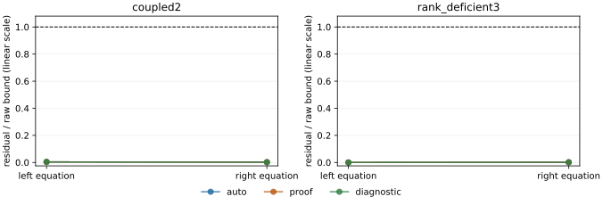
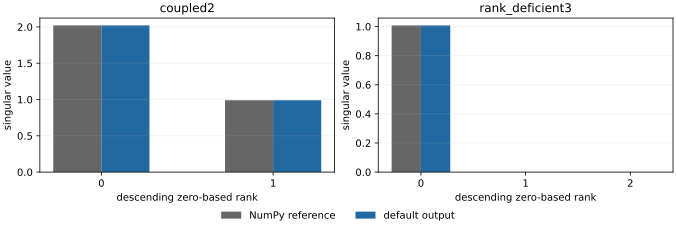
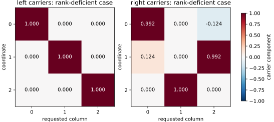

# Rational bidiagonal SVD

A research implementation of selected singular directions of a real upper
bidiagonal matrix. It uses count-based spectral packets and rational filters.
The conservative default is deliberately expensive: binary64 targets use a
220224-bit C++ core. This is a fixed-format complexity construction, with no
claim of practical speed superiority over LAPACK.

The implementation, API, tests, benchmarks and documentation were produced by
AI agents under Kaiwen Jin's direction. Tests and AI review do not imply
independent human review, formal verification or upstream acceptance.

## Install and call

Python >=3.11, a 64-bit C++17 compiler, and Boost >=1.89 headers are required.
The tested backend is Boost 1.89.0. No runtime network download is performed.
Linux and macOS are supported; Windows is currently unsupported (POSIX build lock).

```sh
python -m venv .venv
.venv/bin/python -m pip install .
# If Boost is outside the compiler's normal include path:
export RBSVD_BOOST_INCLUDE=/absolute/directory/containing/boost
```

```python
from rational_bidiagonal_svd import selected_svd

result = selected_svd([2.0, 1.0], [0.25], [0, 1])
print(result.values)
print(result.config)
```

`d` is the diagonal, `e` the superdiagonal. Rank 0 means the largest value;
columns preserve the requested index order. `left` and `right` are binary64
carriers. `left_directions` and `right_directions` represent their exact unit
directions $x/\sqrt{x^Tx}$. A binary64 carrier is not claimed to have exact
unit norm.

For a fast **diagnostic** run with an additional exact check of this instance:

```python
diagnostic = selected_svd([2.0, 1.0], [0.25], [0, 1],
                          profile="diagnostic", verify=True)
assert diagnostic.verification["passed"]
```

The diagnostic core defaults to 4096 bits and does not inherit the general
proof precision guarantee. Exact instance verification has a separately paid,
potentially superlinear cost.

## Default and accuracy contract

`profile="auto"` chooses exact coordinate vectors for a zero matrix and proof
precision otherwise. With target bits $p=53$, it sets $q=3p+32=191$,
4080 coefficient bits and 220224 kernel bits. All actual parameters and
selection reasons are returned in `result.config`. There is no automatic
precision downgrade.

The arithmetic-model bound is $C n2^{-p}\|B\|_2$ for ordered values and
both residual equations, with $C=128$ for the represented unit directions.
Pairwise inner products are bounded by $128n2^{-p}$. Raw carriers instead
have the conservative constant 256 and squared-norm defect at most
$8\,2^{-p}$. Preconditions include $16\le p\le53$, $n2^{-p}\le1/64$,
correctly rounded real primitives, protected exact index/scaling operations,
and exclusion of overflow/underflow. This is a mathematical arithmetic model,
not a formal verification of Python, the compiler or Boost.

Precision-explicit production work is $O(p^4nk)$ operations on $O(p)$-bit
numbers; a conservative bit bound is $O(p^6nk)$. Only after fixing the format
is this $O(nk)$ in dimension and requested count. Compilation, preprocessing,
output and optional verification are reported separately where applicable.

See [the complete API and parameter policy](docs/API.md),
[tests](tests/test_api.py), and [reproducible cases](numerical_case/README.md).

The motivating task is selected bidiagonal singular-vector computation,
including the real-matrix problem described in
[Problem 3.8 of the Simons workshop questions](https://arxiv.org/abs/2602.05394).
The method uses rational interval filters and joint Schur-complement columns;
the accompanying mathematical note states the exact model and precision costs.
For the recorded environment and validation scope, see
[validation notes](docs/VALIDATION.md) and
[reproduction dependencies](requirements-reproduce.txt).



For `coupled2` and `rank_deficient3`, the vertical axis is the larger column
residual for each equation divided by $256n2^{-p}\|B\|_2$; the horizontal axis
identifies the two equations. The three profiles coincide on these cases,
below the dashed bound 1. The linear axis preserves zeros. These observations
describe only the two fixed inputs.



Singular value versus descending zero-based rank for the same two inputs:
the default output agrees with the NumPy reference at this plot's resolution,
including the two zero values of the rank-deficient case. This comparison
does not establish accuracy for untested matrices.



Left and right carriers for `rank_deficient3`: rows are coordinates, columns
are requested triplets, and color/text gives each stored component. The two
sides have different component patterns; a basis in the repeated zero
subspace is not unique. The case notes give definitions, exact checks and
reproduction commands for all three figures.

## Validate and reproduce

```sh
python -m pip install '.[test,figures]'
python -m pytest -q
python numerical_case/benchmark.py --output numerical_case/raw/run.json
python numerical_case/figures.py --input numerical_case/results.json
```

The small default proof tests may take minutes. Cache compilation is protected
by an OS lock; API calls within one process are serialized around mpmath's
precision context. See the API for workspace admission and timeout controls.

## Engineering and contribution evidence

The [paired optimization benchmark](bench/README.md) separates the unchanged
220224-bit default from 4096-bit diagnostics and records exact instance checks,
independent residuals, time distributions and memory. See
[release readiness](docs/RELEASE_READINESS.md), [contribution guidance](CONTRIBUTING.md)
and [citation metadata](CITATION.cff). These measurements do not imply practical
superiority over optimized dense or bidiagonal LAPACK implementations.
